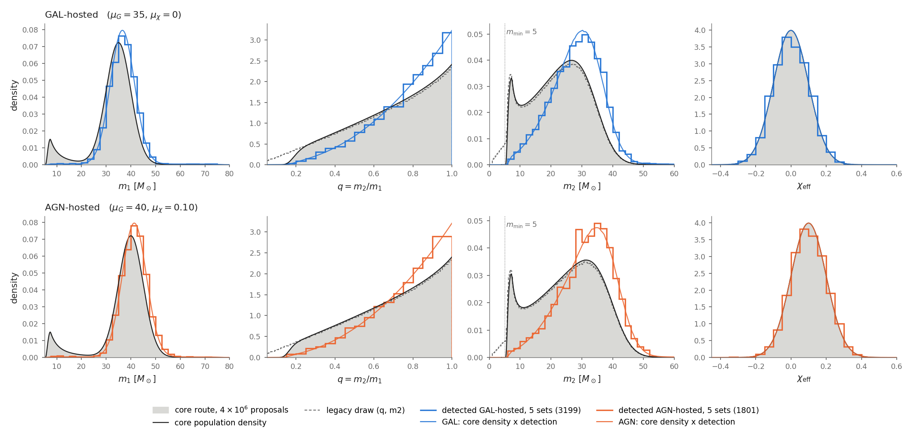

# Core-population event sets (`--population_code core`)

**Status (2026-11-17):** option added to `working/data/generate_dataset.py`; 20 event sets
(seeds 100, 101, 102, 103, 105 x four kinds) generated beside the signed-off ones and
validated. The default path is bit-identical to the record. The injection sets need no
regeneration. Nothing is committed. Second batch, same day: the four kinds on seeds
106-110 and an f_AGN = 0.10 control on 100-105 ("Second batch" below).

## Why

The generator drew masses with the samplers of legacy darksirens 2b86a2d, whose
Gaussian-peak secondaries reach down to 1 Msun. darksirens-core e7c3007 gives those
binaries zero density below m2 = 5 Msun and tapers them up to 8 Msun, so about a third of
the legacy event sets contain an event core cannot explain (Analysis 14 README, "Core and
the mocks disagree below the minimum mass"). Production runs use core, so the events are
redrawn from core's population. The legacy files stay as they are.

## Core's density, read from its code

powerlaw+peak with shared beta/spin/gamma at the mock's input,
theta = [v1 0.1, alpha 2.3, m_min 5, m_max 80, dm_min 3, dm_max 10, mu_G 35, sigma_G 5,
beta 1, mu_chi 0, sigma_chi 0.1, gamma 0] (core's `fixed=True` vector has gamma = 2.5, so
gamma is set by hand). Pointers are under `src/darksirens-core-e7c3007/src/darksirens/`.

    p(m1, q, chi, z) = [w_PL PL(m1) + w_G G(m1)] * q^beta S(q m1; m_min, dm_min) / N(m1)
                       * TN(chi; mu_chi, sigma_chi, [-1, 1]) * (1+z)^(gamma-1)

- **Primary mass.** w_PL = 0.10, w_G = 0.90 (stick weight v1, `population/registry.py:153-161`).
  PL is m^-alpha times the low and high Planck tapers on [5, 80] with widths 3 and 10,
  normalised edge-exactly (`population/parametric.py:52-122`). G is a Gaussian on [1, 200],
  closed-form normaliser and support mask (`parametric.py:213-246, 269-292`;
  `population/base.py:202-267`).
- **Pairing.** `PowerLawPairing` q^beta S(q m1; m_min, dm_min), normalised per m1 over
  (m_min/m1, 1] (`parametric.py:1312-1359`; quadrature `base.py:270-999`). **Both mass
  components pair at the power law's edge (5, 3):** the peak declares no edge and inherits
  it (`MixtureModel._low_mass_edge`, `base.py:1146-1168`, used at `:1189-1219`). This is
  the only difference from the legacy draw, whose peak lanes pair at (1, 0.01). Zero
  density for m2 <= 5 and for m1 <= 5.
- **Taper.** `sfilter_low` (`population/utils.py:829-841`) has the same Planck form as
  legacy's `_sfilter_low`. Its exponent cap is 130 instead of 500, which matters only where
  S < e^-130, i.e. within 0.023 Msun of m_min.
- **Spin.** Gaussian truncated to [-1, 1], trapezoid-normalised (`parametric.py:1424-1449`,
  `base.py:1026-1039`).
- **Redshift.** (gamma - 1) ln(1+z) (`base.py:1378-1398`): with gamma = 0 that is the
  generator's host acceptance (1+z)^-1 exactly, so the host draw is already core's.
- **Host-dependent set.** Core's second branch is the same vector with mu_G,c2 and
  mu_chi,c2 replaced (`runtime_binding.py:361-382`, `paper_prd/notes/LIKELIHOOD_MATH.md`
  §5, §7). The AGN class is therefore mu_G = 40, mu_chi = 0.10, still pairing at (5, 3).
- **No sampler.** Core ships none for this density: no `sample`/`draw` function in
  `population/` and no mock-generator script. `MixtureModel.mass_q_density` is a density
  for an external flow surrogate.

## The route: an exact coupled rejection on the pairing alone

Core's density equals the legacy draw everywhere except the conditional pairing of the
peak lanes, and that ratio has a closed form. Tabulating core or rejecting on the joint
ratio is therefore unnecessary. `core_pairing_correction` in the generator works as follows.

1. Draw everything exactly as the legacy path does, on the main stream: host, m1 and its
   component flag, legacy q, chi_eff, measurement noise.
2. On a child stream (`SeedSequence(seed_events, spawn_key=(0x4350,))`), keep the legacy q
   with probability r = S_core(m2; 5, 3) / S_lane(m2). r <= 1 wherever legacy can draw,
   and r = 1 on every power-law lane.
3. Otherwise redraw q from core's pairing by rejection: q^beta on [5/m1, 1] proposed by
   gmd's `_sample_q_hard`, accepted with S_core.
4. Drop proposals core gives zero density (m1 <= 5, |chi_eff| > 1) before detection.

The kept-or-redrawn q is distributed exactly as q^beta S_core(q m1) / N(m1) for every m1,
so (m1, q, chi) follows core's density. S_core is a float64 numpy mirror of core's
`sfilter_low` (`core_sfilter_low`). The generator never imports core. It refuses `core`
unless `--core_darksirens` is at `CORE_POP_COMMIT` = e7c3007, the commit this closed form
was checked against.

Tally over 4e6 proposals: 3.3% (GAL) / 2.5% (AGN branch) of all lanes get a redrawn q, at
most 4 redraw rounds are needed, and no lane is dropped or left unresolved. Per 1000-event
set, 21-45 detected events carry a redrawn q (`truth/core_q_redrawn`).

**Bounded approximations** (all far below what 1000 events resolve):
- Taper floor (S < e^-130, m2 within 0.023 Msun of 5): the probability under core is
  ~1e-56.
- The legacy power-law lanes' own fallback: after 10,000 failed rejection rounds,
  `_sample_q` returns a hard q^beta draw. This affects only m1 in (5, 5.47), with
  probability 1.2e-6 per proposal, the same as in the record. Core gives those binaries
  finite density.
- Shifted marked spin: chi + 0.10 can exceed 1 only in the 9-sigma tail (dropped if it
  ever happens; 0 so far). The missing core mass below chi = -0.9 is 8e-24.

**Metadata** (only a core draw carries it, so a file without it is legacy). Attributes:
`population_code = "core"`, `population_core_commit`, `population_route`,
`population_table_sha256 = "none (closed form, no table)"`. `metadata_json` carries a
`population_code` block: density, route, child-stream derivation, core worktree HEAD,
`generator_sha256`, the per-proposal tally and the number of detected events with a
redrawn q.

## Generator changes (`git diff working/data/generate_dataset.py`)

- `--population_code {legacy,core}` (default `legacy`) and `--core_darksirens`.
- New functions `core_sfilter_low`, `new_core_tally`, `core_pairing_correction` and
  `draw_source_population`. The events loop now calls the last of these, which makes the
  record's calls in the record's order.
- Validation stage: with `--events_suffix` it validates `events<SFX>.h5` alone. It runs
  V1, V2, V2b, V3, V3c, V5 and V7, writes `validation/validation_events<SFX>.json`, and
  opens no catalog, survey or injection file. `validation.json` and META.json are never
  touched (`main()` skips `finalise_meta` in that case). Without the suffix the stage is
  unchanged.
- V5 in that mode tests the file's own planted f_AGN (exact host count when f is 0 or 1).
  For a set with a mass mark (dmu_G_agn != 0) the detected share is the planted f
  re-weighted by the two classes' detection efficiencies, so V5 checks bookkeeping only
  there. The selection-corrected test is below.

## Bit-identity of the default path

`scripts/bitcheck_default.sh` uses Analysis 0's dataset-level gate on four draws covering
every touched path: mixed set (seeds 100 and 103), all-AGN set, and host-dependent set
(child mass stream).

| comparison | mixed s100 | mixed s103 | all-AGN s100 | host-dependent s100 |
|---|---|---|---|---|
| unmodified generator (git HEAD 85f2934) vs modified, same machine | PASS | PASS | PASS | PASS |
| signed-off file on disk vs modified (numpy AVX-512 off) | PASS | PASS | PASS | PASS |

All 50 datasets of each file are byte-identical (`results/bitcheck_*.json`).

**Finding: AVX-512.** On miko (Xeon Gold 6526Y), numpy 1.26 dispatches transcendental
loops to AVX-512, which rounds 1 ulp differently from the loops the record was made with.
The unmodified generator then reproduces the record only to 1 ulp (11 of 1000 primary
masses, max relative difference 2.2e-16). With `NPY_DISABLE_CPU_FEATURES` set to the
AVX-512 group it reproduces the record bitwise
(`results/bitcheck_record_vs_HEAD_noavx512_mixed_s100.json`). The corepop sets were
generated that way, so their shared events are bitwise those of the legacy files.

The full default validation stage (12 checks) was also rerun on seed 100 with both
generators, in a scratch copy whose inputs were symlinks to the signed-off seed. Both pass
12/12, and the two `validation.json` files agree in all 260 leaves except the timestamp
(`scripts/fullval_compare.py`, `results/fullval_regression_s100.json`). The scratch outputs
(`gws-agn-data-v3-scratch-corepop/`) were deleted afterwards; `bitcheck_default.sh`
recreates them.

## Files written

Under `/hildafs/projects/phy230054p/magana/gws-agn-data-v3/seed<S>/` (reached through
`working/data/seed<S>`), for S = 100, 101, 102, 103, 105:

| kind | file | flags (as the legacy file of the same kind) | sub-seed |
|---|---|---|---|
| mixed, f_AGN = 0.30 | `events/events_corepop.h5` | none | S*1000+3 |
| all hosts AGN | `events/events_pureagn_corepop.h5` | `--f_agn 1.0` | S*1000+9 |
| all hosts galaxies | `events/events_puregal_corepop.h5` | `--f_agn 0.0` | S*1000+8 |
| host-dependent | `events/events_marked_dmu0p10_dmuG5_corepop.h5` | `--dmu_chi_agn 0.10 --dmu_G_agn 5` | S*1000+3 |

Each set has 1000 events x 2000 samples and is 162.7-162.9 MB. Each comes with
`events_rejected_sample<SFX>.h5` (1.3 MB), `events_meta<SFX>.json` and
`validation/validation_events<SFX>.json`. That is 80 new files and 3.29 GB in total. No
pre-existing file changed (sizes and mtimes of all 116 files under events/, validation/
and META.json compared before and after; all five META.json md5 unchanged). Only seed 100
had a legacy host-dependent set; the other four are new kinds there.

## Correspondence with the legacy files

The main stream is untouched, so every proposal keeps its host, m1, chi_eff and noise
variates. Only peak lanes whose legacy secondary fell below about 8 Msun get a new q.

- In each set, 955-979 of the 1000 events are bit-identical to an event of the legacy
  file of the same kind: same host, z, m1, q, chi_eff and recorded measurement (all
  `truth/obs_*` identical).
- 1-8 events are the same proposal with a moved q, and 18-39 events are new to the core
  set.
- PE samples are positional, so they coincide only over the leading run of positionally
  identical events (1-85 events). From the first event that differs, the PE noise belongs
  to other events. The rejected-sample file also differs from there on.

## Validation

| seed | set | checks passed | min true m2 | max frac. samples < 5 | core ln p finite | detected KS min p | events with q redrawn | events shared with legacy |
|---|---|---|---|---|---|---|---|---|
| 100 | mixed | V1 V2 V2b V3 V3c V5 V7 | 7.33 | 0.722 | yes | 0.417 | 26 | 974 |
| 101 | mixed | V1 V2 V2b V3 V3c V5 V7 | 6.89 | 0.574 | yes | 0.189 | 30 | 970 |
| 102 | mixed | V1 V2 V2b V3 V3c V5 V7 | 6.41 | 0.324 | yes | 0.448 | 41 | 959 |
| 103 | mixed | V1 V2 V2b V3 V3c V5 V7 | 7.16 | 0.238 | yes | 0.117 | 21 | 979 |
| 105 | mixed | V1 V2 V2b V3 V3c V5 V7 | 6.76 | 0.492 | yes | 0.100 | 38 | 962 |
| 100 | all-AGN | V1 V2 V2b V3 V3c V5 V7 | 5.75 | 0.215 | yes | 0.717 | 32 | 968 |
| 101 | all-AGN | V1 V2 V2b V3 V3c V5 V7 | 5.86 | 0.354 | yes | 0.001 (chi_eff; inherited) | 35 | 965 |
| 102 | all-AGN | V1 V2 V2b V3 V3c V5 V7 | 5.72 | 0.538 | yes | 0.134 | 23 | 977 |
| 103 | all-AGN | V1 V2 V2b V3 V3c V5 V7 | 6.93 | 0.081 | yes | 0.309 | 22 | 978 |
| 105 | all-AGN | V1 V2 V2b V3 V3c V5 V7 | 6.23 | 0.581 | yes | 0.113 | 45 | 955 |
| 100 | all-GAL | V1 V2 V2b V3 V3c V5 V7 | 6.63 | 0.263 | yes | 0.139 | 32 | 968 |
| 101 | all-GAL | V1 V2 V2b V3 V3c V5 V7 | 6.35 | 0.606 | yes | 0.099 | 34 | 966 |
| 102 | all-GAL | V1 V2 V2b V3 V3c V5 V7 | 6.13 | 0.715 | yes | 0.036 | 28 | 972 |
| 103 | all-GAL | V1 V2 V2b V3 V3c V5 V7 | 6.83 | 0.351 | yes | 0.358 | 33 | 967 |
| 105 | all-GAL | V1 V2 V2b V3 V3c V5 V7 | 5.82 | 0.885 | yes | 0.293 | 30 | 970 |
| 100 | host-dep. | V1 V2 V2b V3 V3c V5 V7 | 7.32 | 0.065 | yes | 0.386 | 27 | 973 |
| 101 | host-dep. | V1 V2 V2b V3 V3c V5 V7 | 6.58 | 0.590 | yes | 0.048 | 28 | - |
| 102 | host-dep. | V1 V2 V2b V3 V3c V5 V7 | 7.08 | 0.838 | yes | 0.161 | 29 | - |
| 103 | host-dep. | V1 V2 V2b V3 V3c V5 V7 | 7.16 | 0.221 | yes | 0.148 | 26 | - |
| 105 | host-dep. | V1 V2 V2b V3 V3c V5 V7 | 6.29 | 0.405 | yes | 0.159 | 35 | - |

**Generator checks.** All 20 files pass V1, V2, V2b, V3, V3c, V5 and V7 (`validation_events<SFX>.json`).

**Low m2** (`results/low_m2.json`; Analysis 14's `diag_low_m2.table` imported unchanged).
- Corepop sets: smallest true m2 is 5.72 Msun, no event has true m2 < 5, and no event has
  more than 95% of its samples below 5. The largest such fraction is 0.886, for an event
  with true m2 = 5.8, whose broad q posterior spills below the edge.
- Legacy sets of the same seeds: 23 events with true m2 < 5, and 7 sets with an event
  above 95%.

**Core's density at the truths** (`results/core_logp_truth.json`, core venv, both pairing
modes).
- ln p is finite for every event of every corepop file, each host-dependent event under
  its class's population.
- 13 of the 16 legacy counterparts have 1-4 events at -inf.
- Every corepop file loads through core's `load_gw_store`. The normalised p_pe rows sum to
  1 within 3.3e-16, and PE-reweighting ESS/nsamp is at least 0.83.

**Density identity** (`results/density_identity.json`). Core's ln p (evaluated in core's
venv) was compared with the closed form the route samples (scipy quadrature, independent
of both codes) at 100,000 points spanning the support and the taper band.
- Outside the taper floor, max |Delta ln p| = 1.1e-7, in both the "historical"
  (per-sample pairing, as Analyses 13/14 run) and the default (per-point) mode.
- Inside the floor zone (m2 within 0.023 Msun of 5) the difference is 7.0e-4 / 2.8e-4.
  That is core's own quadrature, at relative density e^-14 or below.
- The edge values reproduce Analysis 14's table: -inf at m2 = 4.9, -31.72 at 5.1, -4.29 at
  6.0, -0.765 for (35, 30).
- Core's p(m1, q) integrates to 1 + 4e-8. P(m2 < 6) = 0.0044 and P(m2 < 8) = 0.062 (GAL)
  / 0.058 (AGN).

**Sampler** (`results/sampler_gof.json`). 4e6 proposals per branch were drawn through the
generator's own `draw_source_population` and compared by one-sample KS with core's
marginals. The KS distance resolves 7e-4 at this N, against 0.043 for 1000 events.

| branch | mode | m1 D (p) | q D (p) | m2 D (p) | chi_eff D (p) | P(m2 < 5) | P(m2 < 8), core |
|---|---|---|---|---|---|---|---|
| GAL | core | 5.1e-4 (0.26) | 3.0e-4 (0.87) | 3.1e-4 (0.83) | 3.0e-4 (0.86) | 0 | 0.0622 (0.0623) |
| GAL | legacy | 5.1e-4 (0.26) | 0.031 (0) | 0.032 (0) | 3.0e-4 (0.86) | 0.0188 | 0.0941 |
| AGN | core | 4.1e-4 (0.53) | 5.6e-4 (0.16) | 3.2e-4 (0.79) | 4.0e-4 (0.55) | 0 | 0.0579 (0.0578) |
| AGN | legacy | 4.1e-4 (0.53) | 0.024 (0) | 0.024 (0) | 4.0e-4 (0.55) | 0.0142 | 0.0821 |

**Detected sets** (`results/detected_gof.json`, figure). The detected truths were compared
by KS with core's density times the generator's detection probability, built from each
seed's own catalog redshifts.
- 100 tests in all: p-values consistent with uniform (KS of the p-values 0.20), 3% below
  0.05.
- The one low value is chi_eff of seed 101's all-AGN set (p = 0.0011). Its chi_eff draws
  are those of the legacy file (p = 0.0015 there), so it is that realisation and not the
  route.
- The legacy files' m2 also pass this test (p >= 0.12): 1000 events cannot resolve the 3%
  of events that differ, though one of them drives core's likelihood.

**Host-dependent set: selection-corrected V5 and the class offsets.**

| seed | expected detected AGN share | realised | pull | Delta mean chi_eff (AGN - GAL) | Delta mean m1 [Msun] (predicted 4.6) |
|---|---|---|---|---|---|
| 100 | 0.366 | 0.360 | -0.41 | 0.098 +- 0.007 | 4.63 +- 0.37 |
| 101 | 0.370 | 0.380 | +0.67 | 0.109 +- 0.006 | 4.07 +- 0.41 |
| 102 | 0.367 | 0.364 | -0.21 | 0.100 +- 0.007 | 4.83 +- 0.38 |
| 103 | 0.368 | 0.346 | -1.45 | 0.098 +- 0.007 | 4.35 +- 0.41 |
| 105 | 0.370 | 0.351 | -1.21 | 0.094 +- 0.007 | 5.02 +- 0.38 |
| pooled | | | | 0.0999 +- 0.0030 (planted 0.10) | 4.58 +- 0.17 (predicted 4.65) |

The planted offsets are +5 in mu_G and +0.10 in mu_chi. Detected m1 differs by less than
+5 because the shared power law and selection damp it, so it is compared with its own
prediction.



`figs/corepop_population.{pdf,png}`: rows are the GAL- and AGN-hosted classes of the
host-dependent set; columns are m1, q, m2, chi_eff.
- Grey fill: 4e6 core-route proposals. Black line: core's density. Dashed: the legacy
  draw.
- Coloured step: detected events, five sets pooled. Coloured line: core's density times
  detection.

## Injections: no regeneration needed (`results/injection_check.json`, seed 100)

Changing the population code multiplies each injection's weight by
R = p_core(m1, q, chi) / p_legacy(m1, q, chi), since the host, redshift and Jacobian
factors are common.

- **Proposal density.** The stored `pdraw_population` is the legacy density to 1.1e-15,
  and `pdraw` is positive and finite on every row.
- **Support.** No point has core density where the legacy proposal is zero (grid over
  core's whole support and every detected injection).
- **Zero-weight injections.** 2895 of 2,205,380 targeted and 1544 of 1,230,471 popuni
  detected injections (0.13%) have m2 < 5; under core they get weight 0.
- **Ratio on detected injections.** R <= 1.066 (median 1.03) on every detected injection
  of both lanes, in every branch.
- **Weight bound.** On a grid R peaks at 3007 at m1 = 5.05, q = 1, but that is a ratio of
  two vanishing densities. The weight itself, w = p_pop / pdraw (uniform-in-volume
  redshift prior, as the population branch draws), is bounded over core's whole support
  by the uniform branch: w <= 1.63 (targeted; legacy 1.54) and w <= 1.18 (popuni; legacy
  1.11). The realised maxima reach those bounds.
- **Effective number.** It changes by -0.12% (targeted) and -0.35% (popuni).

## Further seeds (106-199)

The 94 seeds 106-199 kept surveys, events and injections, but `catalogs/` was deleted
(`campaign_100seeds/README.md`), and the events stage needs the complete catalogs.

Per seed:
1. `--stage catalogs` (295-318 s, median 301 s, measured on RM in September).
2. **Gate:** regenerate the legacy `events.h5` into scratch and compare it bitwise with the
   one on disk. This proves the catalogs and the floating point are reproduced; RM's CPU
   type is not exposed, so do not assume the AVX-512 setting.
3. The four core sets (about 20 s each on RM).
4. Events-only validation (about 8 s each).
5. Delete `catalogs/`.

Cost: about 7.5 min per seed with 8 CPUs and 64 GB, i.e. about 90 core-hours for all 94
seeds, or about 45 min wall time at 16 concurrent array tasks (as `submit_gen.sbatch`).
Disk retained is 0.66 GB per seed (62 GB in all), plus 6.7 GB per seed in flight for the
transient catalogs (about 107 GB peak at 16-way). phy230054p is at 4.6 of 19.5 TB.

Done for 106-110 (next section); measured 10.5-11 min per seed on RM.

## Second batch (2026-11-17): seeds 106-110, and the f_AGN = 0.10 control

**Realisations 106-110** are the next five after 105; none was skipped (104, before them,
is skipped throughout: it failed V6 in the original campaign and was never used). Each has
both complete and all four flux-limited surveys (m21-m18) of both tracers, both injection
lanes, the legacy event files, and a full validation that passed (12/12,
`campaign_100seeds/manifest/seeds.tsv`). Like every seed from 106 on, its `catalogs/` had
been pruned, so the plan of "Further seeds" was followed with one change: the catalogs stage
merges into META.json, so it ran against a scratch outroot, never the dataset.

`scripts/more_seeds_job.sh` (RM array 1414829 via `scripts/submit_more_seeds.sbatch`; nodes
Xeon E5-2695 v3, no AVX-512; 8 CPUs, 64 GB), per seed:
1. `--stage catalogs` into scratch (382-405 s, 5.4 GB);
2. **gate**: `events.h5`, `events_pureagn.h5`, `events_puregal.h5` regenerated from the
   rebuilt catalogs and compared dataset by dataset with the files on disk: all 15 files
   byte-identical with numpy's default dispatch (97 s; `results/more_seeds/gate_default_*.json`);
3. the four kinds with `make_corepop_events.sh`'s flags and sub-seeds, written into the
   seed's `events/` through a scratch outroot whose `events/` and `validation/` are symlinks
   to the seed's own (20-27 s each), then the events-only validation (12-18 s each);
4. the scratch tree, catalogs included, deleted. Total 625-664 s per seed.

**The f_AGN = 0.10 control**: `events_fagn0p10_corepop.h5` on seeds 100, 101, 102, 103,
105 (`../obslike/scripts/make_sets.sh fagn0p10`, RM job 1414859): equal populations,
`--population_code core --f_agn 0.10 --seed_events S*1000+10 --n_events 1000 --nsamp 2000`.
Offset 10 is used by no other set, so the control is independent of every existing draw
(it has no legacy counterpart). 42 s to generate and 17-18 s to validate per set.

| seed | set | checks passed | min true m2 | max frac. samples < 5 | core ln p finite | events with q redrawn | events shared with legacy | AGN share |
|---|---|---|---|---|---|---|---|---|
| 106 | mixed | V1 V2 V2b V3 V3c V5 V7 | 7.65 | 0.281 | yes | 32 | 968 | 0.307 |
| 106 | all-AGN | V1 V2 V2b V3 V3c V5 V7 | 6.91 | 0.709 | yes | 30 | 970 | 1 |
| 106 | all-GAL | V1 V2 V2b V3 V3c V5 V7 | 6.73 | 0.611 | yes | 42 | 958 | 0 |
| 106 | host-dep. | V1 V2 V2b V3 V3c V5 V7 | 6.38 | 0.675 | yes | 36 | - | 0.379 |
| 107 | mixed | V1 V2 V2b V3 V3c V5 V7 | 7.32 | 0.203 | yes | 29 | 971 | 0.303 |
| 107 | all-AGN | V1 V2 V2b V3 V3c V5 V7 | 6.33 | 0.397 | yes | 40 | 960 | 1 |
| 107 | all-GAL | V1 V2 V2b V3 V3c V5 V7 | 5.87 | 0.843 | yes | 33 | 967 | 0 |
| 107 | host-dep. | V1 V2 V2b V3 V3c V5 V7 | 6.21 | 0.476 | yes | 20 | - | 0.354 |
| 108 | mixed | V1 V2 V2b V3 V3c V5 V7 | 7.33 | 0.076 | yes | 34 | 966 | 0.313 |
| 108 | all-AGN | V1 V2 V2b V3 V3c V5 V7 | 6.71 | 0.174 | yes | 29 | 971 | 1 |
| 108 | all-GAL | V1 V2 V2b V3 V3c V5 V7 | 6.52 | 0.129 | yes | 22 | 978 | 0 |
| 108 | host-dep. | V1 V2 V2b V3 V3c V5 V7 | 7.15 | 0.416 | yes | 33 | - | 0.359 |
| 109 | mixed | V1 V2 V2b V3 V3c V5 V7 | 5.75 | 0.736 | yes | 24 | 976 | 0.344 |
| 109 | all-AGN | V1 V2 V2b V3 V3c V5 V7 | 7.04 | 0.173 | yes | 36 | 964 | 1 |
| 109 | all-GAL | V1 V2 V2b V3 V3c V5 V7 | 6.21 | 0.422 | yes | 33 | 967 | 0 |
| 109 | host-dep. | V1 V2 V2b V3 V3c V5 V7 | 8.01 | 0.074 | yes | 25 | - | 0.394 |
| 110 | mixed | V1 V2 V2b V3 V3c V5 V7 | 7.16 | 0.143 | yes | 25 | 975 | 0.307 |
| 110 | all-AGN | V1 V2 V2b V3 V3c V5 V7 | 6.21 | 0.545 | yes | 33 | 967 | 1 |
| 110 | all-GAL | V1 V2 V2b V3 V3c V5 V7 | 6.58 | 0.530 | yes | 31 | 969 | 0 |
| 110 | host-dep. | V1 V2 V2b V3 V3c V5 V7 | 7.16 | 0.068 | yes | 21 | - | 0.355 |
| 100 | f_AGN 0.10 | V1 V2 V2b V3 V3c V5 V7 | 6.29 | 0.142 | yes | 39 | - | 0.097 |
| 101 | f_AGN 0.10 | V1 V2 V2b V3 V3c V5 V7 | 7.69 | 0.209 | yes | 34 | - | 0.095 |
| 102 | f_AGN 0.10 | V1 V2 V2b V3 V3c V5 V7 | 6.06 | 0.630 | yes | 27 | - | 0.113 |
| 103 | f_AGN 0.10 | V1 V2 V2b V3 V3c V5 V7 | 7.28 | 0.466 | yes | 29 | - | 0.084 |
| 105 | f_AGN 0.10 | V1 V2 V2b V3 V3c V5 V7 | 6.77 | 0.472 | yes | 22 | - | 0.097 |

- All 25 files: 1000 events x 2000 samples, every events-only check passes, no event has a
  true m2 below 5 Msun (smallest 5.75), no event has more than 95% of its samples below 5
  (largest 0.843), core's ln p is finite at every truth in both pairing modes, and every
  file loads through core's `load_gw_store` (`results/more_core_logp_truth.json`, from
  `../obslike/scripts/core_family.py truth ... mock`; `results/more_summary.json`, from
  `scripts/summarize_more.py`).
- Events shared with the legacy file of the same kind (host, z, m1, q, chi_eff and every
  recorded observation bit-identical): 958-978, as in the first batch.
- f_AGN = 0.10 control: binomial pulls of the AGN share -0.32, -0.53, +1.37, -1.69, -0.32.
- Host-dependent sets: detected-class offsets Delta mean chi_eff = 0.095, 0.093, 0.102,
  0.103, 0.112 (+-0.007 each; planted 0.10) and Delta mean m1 = 5.00, 4.84, 4.76, 4.13, 5.13
  Msun (+-0.4 each; predicted 4.65). AGN shares 0.354-0.394 against the 0.366-0.370 the
  first batch's catalogs predict (largest pull +1.7, seed 109); the per-seed
  selection-corrected prediction and the detected-set KS of `detected_gof.py` need the
  catalogs, which are pruned again, so they were not run for this batch.

### The short paper's experiment sets (2026-11-17, `paper_short_independent/EXPERIMENT.md`)

`working/data/experiment_sets.json` maps (family, f_AGN, s) to the files of every set of that
table, existing ones included, with per-realisation existence (`obslike/scripts/
write_experiment_sets.py`; re-run it to refresh). New here, on 100, 101, 102, 103, 105, core
population, 1000 x 2000 (`obslike/scripts/make_sets.sh <kind>`, RM jobs 1414916-1414918):

| kind | file | flags | sub-seed |
|---|---|---|---|
| s = 0, f = 0.5 | `events_fagn0p50_corepop.h5` | `--f_agn 0.50` | S*1000+13 |
| s = 1, f = 0.1 | `events_marked_dmu0p10_dmuG5_fagn0p10_corepop.h5` | `--dmu_chi_agn 0.10 --dmu_G_agn 5 --f_agn 0.10` | S*1000+10 |
| s = 1, f = 0.5 | `events_marked_dmu0p10_dmuG5_fagn0p50_corepop.h5` | `--dmu_chi_agn 0.10 --dmu_G_agn 5 --f_agn 0.50` | S*1000+13 |

A host-dependent set shares the sub-seed of the equal-population set of the same f (+10,
+3, +13), so hosts and galaxy-class draws are common across s at fixed f (as for the record's
pair at f = 0.3).

- All 15 pass V1-V7. Smallest true m2 5.70; no event has more than 0.73 of its samples below
  5; core ln p is finite at every truth under each event's class population; core's loader
  reads every file (`obslike/results/experiment_core_logp_truth_peak.json`).
- **Selection-corrected V5** (`obslike/scripts/v5_selection_corrected.py` ->
  `obslike/results/v5_selection_corrected.json`; expected share from each seed's own
  catalogs, as `detected_gof.py`). The AGN/galaxy detection-efficiency ratio is 1.010-1.027
  at s = 0 and 1.349-1.369 at s = 1. Per group of five realisations, chi^2 of the pulls:
  f 0.1 s 0: 6.0; f 0.3 s 0: 6.8; f 0.1 s 1: 3.1; f 0.3 s 1: 4.2; f 0.5 s 1: 9.4;
  **f 0.5 s 0: 21.7** (pulls -2.18, +2.04, -1.41, +3.05, +1.23; p = 6e-4). Large-N test
  (`obslike/scripts/v5_largeN.sh`, scratch, 20,000 detected events at f = 0.5, sub-seed
  S*1000+90): AGN share 0.5011 +- 0.0035 on seed 100 (expected 0.502) and 0.5062 +- 0.0035 on
  seed 103 (expected 0.505). The generator is unbiased at f = 0.5, so the five sets' scatter
  is a fluctuation (p = 6e-4 for this group; about 4e-3 across the six groups). The sets are
  kept as drawn.
- **The record's lanes do not serve host-dependent analyses well**
  (`obslike/scripts/inj_stress.py mock <S> <lane> <out> {1,2}`,
  `obslike/results/inj_stress_peak_existing_s<S>_x{1,2}.json`). Host-dependent mixture
  N^2/N_eff:
  - s = 1: 1.6 / 3.0 / 5.4-5.7 at f = 0.1 / 0.3 / 0.5 (worst stressed point 2.9 / 8.9 / 18);
  - s = 2: 12-15 / 65-86 / 131-170, with the AGN class alone at 280-355.
  Hence the dedicated lane below.
- **s = 2 sets** (+10 Msun, +0.20; `make_sets.sh m2f010|m2f030|m2f050`, sub-seeds +10, +3, +13;
  `events_marked_dmu0p20_dmuG10{_fagn0p10,,_fagn0p50}_corepop.h5`, 100-105).
  - All 15 pass V1-V7. Smallest true m2 5.70; core ln p is finite under the AGN class
    (mu_G 45, mu_chi 0.20); core's loader reads every file
    (`obslike/results/experiment_core_logp_truth_peak_s2.json`).
  - Selection-corrected V5 (efficiency ratio 1.75-1.77): chi^2 2.1, 5.7 and 6.1 for 5 at
    f = 0.1, 0.3 and 0.5.

### Dedicated peak-family injection lane (`injections/injections_targeted_peak.h5`, 100-110)

For host-dependent analyses with AGN offsets from 0 to twice the present ones.
`obslike/scripts/inj_make_peak.sh` (RM array 1414956), per realisation:

- **Proposal** (`--inj_proposal_json "$(cat obslike/scripts/inj_proposal_peak.json)"`): the
  mass/spin proposal of the population and AGN-targeted branches is a MIXTURE of legacy
  PopulationConfigs (new generator option; the density is the weighted sum of each
  component's legacy density, so pdraw stays exact):

  | weight | mass peak [Msun] | chi_eff | role |
  |---|---|---|---|
  | 0.50 | 35 +- 5 | 0 +- 0.10 | galaxy class |
  | 0.15 | 40 +- 5 | 0.10 +- 0.10 | AGN class, s = 1 |
  | 0.20 | 45 +- 5 | 0.20 +- 0.10 | AGN class, s = 2 |
  | 0.15 | 40 +- 9 | 0.05 +- 0.25 | broad |

  The power law and pairing are the present family's.
- **Branches** 0.82 population / 0.03 uniform / 0.15 AGN-targeted; targeted cut and cap 0.5
  (the record's). Lane seed S*1000+16.
- **Size and time**: 2.5e8 proposals give 2.94-2.98e6 detected rows (about 0.23 GB per
  realisation) in 5-5.5 min on 8 RM CPUs.
- **Checks**: pdraw equals the mixture of its components exactly. 3000 rows were recomputed
  independently, the targeted density by brute force, to 1e-15 (`obslike/results/
  inj_check_peak_s<S>.json`).
- **How the weights were chosen**: a 1e8-proposal pilot reweighted over 52 combinations of
  component and branch weights (`obslike/scripts/inj_mix_opt_peak.py`,
  `obslike/results/inj_mix_opt_peak{,2}_s100.json`).
- **Regressions** of the generator change:
  - the default injection path is byte-identical to git HEAD;
  - the single-proposal path reproduces the stored obslike lane exactly
    (`obslike/results/inj_regress2_*.json`).

N^2/N_eff (N = 1000; `obslike/results/inj_stress_peaklane_s<S>_x{1,2}.json`), range over the
ten realisations. Stressed points: mu_G 31, 39; sigma_G 3.5, 7; H0 55, 90; mu_chi 0.05;
sigma_chi 0.15. The worst point is mu_G 31, except for s = 2 at f = 0.5 (mu_G 39).

| analysis | f 0.1 design / worst | f 0.3 | f 0.5 |
|---|---|---|---|
| s = 0, equal populations | 1.19 / 2.75 | 1.20 / 2.63 | 1.56 / 3.39 |
| s = 1, host-dependent | 1.09 / 2.44 | 1.05 / 1.89 | 1.35 / 2.10 |
| s = 2, host-dependent | 1.03 / 2.22 | 1.22 / 1.83 | 1.81 / 2.88 |
| *s = 0 on the record's lane (seed 100)* | *1.42 / 3.05* | *1.20 / 2.42* | *1.33 / 2.56* |

- Per class: galaxy 1.36 (worst 3.2; record's lane 1.70 / 3.7); AGN at s = 1 2.65 (3.8); AGN at
  s = 2 3.5 (5.9).
- All mergers in AGN (f = 1): 3.4 (7.5) on the new lane, against 2.6 (5.0) on the record's
  lane, so that set keeps the record's lane.
- `experiment_sets.json` gives each set its lane (field `injections`).

Disk: 80 files, 3.28 GB (106-110) and 20 files, 0.82 GB (control). Transient: 5.4 GB of
catalogs per seed in scratch, deleted. All 140 files written today across Tasks 1-3 were
checked to be new (nothing else under seed100-110 changed; META.json md5 of 100-105 equal
to `cache/META_md5_before.txt`; META.json of 106-110 untouched since September).

## Third batch (2026-11-21): seeds 111-120

Ten further realisations, the next ten after 110, for Analysis 16's test of KnownBoth's H0 offset
(`analyses/analysis_16_production_runs/README.md`, stage X, "21 Nov, third batch"). **Only the mixed
kind was drawn**: `events/events_corepop.h5` (f_AGN 0.30, core population, `--population_code core
--events_suffix _corepop`), the event set of stage 1's two-catalog analysis; no all-AGN, all-galaxy or
host-dependent set. Like 106-110 the seeds' `catalogs/` had been pruned; the complete catalogs were
**regenerated and are kept** (`catalogs/catalog_{gal,agn}_complete.h5`, 5.4 GB per seed; the
regeneration's record `catalogs/regen_META.json`; the seed's `META.json` untouched, md5 equal before
and after) with numpy's AVX-512 dispatch disabled: glass venv (numpy 2.4)
`NPY_DISABLE_CPU_FEATURES="X86_V4 AVX512_ICL AVX512_SPR"`, and the jax env's steps (numpy 1.26) with
its AVX-512 groups off, as `more_seeds_job.sh`. The node (miko) has AVX-512, the RM nodes that made the
records do not; with AVX-512 on, 0.3% of the AGN `z_obs` differ from the record by one ulp (Analysis
16 README, stage X (f)).

`scripts/more_realizations_pipeline.sh` (8 threads per process; seed 111 first, then 112-114, 115-117
and 118-120 in three parallel streams), per seed:
1. `--stage catalogs` against a scratch outroot under the seed (`catalogs_regen_tmp/`: the stage
   merges into META.json), then moved to `catalogs/` (205-258 s, median 210);
2. **bitwise checks** (44-51 s): the three legacy files `events.h5`, `events_pureagn.h5`,
   `events_puregal.h5` regenerated from the rebuilt catalogs into scratch and compared dataset by
   dataset with the records: all 50 datasets of each of the 30 files identical (their metadata-JSON
   attribute differs only in `generated_at_utc` and the three `branch_*` keys the present generator
   records); and the AGN nside-32 survey file rebuilt from the catalog
   (`make_survey_nside.py --nside 32 --tracers agn --reproduce`): `zgals`, `dzgals`, `wgals`, `ngals`
   identical to `surveys/survey_agn_complete_ns32.h5`;
3. the mixed set, written into the seed's `events/` through a scratch outroot whose `catalogs/`,
   `events/` and `validation/` are symlinks to the seed's own (12-15 s), then the events-only
   validation (6-10 s): all seven checks pass (V1 V2 V2b V3 V3c V5 V7);
4. the nside-64 survey files of both complete catalogs, `surveys_ns64/survey_{gal,agn}_complete_ns64.h5`
   (`make_survey_nside.py --seed S --nside 64`, 1.7 GB per seed), each with its passing
   `<file>.check.json` (object counts, the four children of every nside-32 pixel, redshifts per
   parent bit for bit).

Steps 3-4 took 204-243 s; a seed 457-481 s in the three streams (552 s for 111). The pipeline's
per-seed summaries are `results/more_realizations/sNNN/summary.json` (its logs, gate comparisons and
scratch trees stayed in the run's scratch directory, `SCR`).

| seed | gate (3 legacy files) | AGN nside-32 rebuilt | validation | nside-64 surveys | META.json | AGN-hosted of 1000 (pull) | catalogs | checks | events | validation | total (s) |
|---|---|---|---|---|---|---|---|---|---|---|---|
| 111 | PASS | PASS | PASS | PASS | unchanged | 332 (+2.21) | 258 | 51 | 15 | 8 | 552 |
| 112 | PASS | PASS | PASS | PASS | unchanged | 258 (-2.90) | 211 | 45 | 12 | 6 | 460 |
| 113 | PASS | PASS | PASS | PASS | unchanged | 311 (+0.76) | 209 | 47 | 12 | 6 | 469 |
| 114 | PASS | PASS | PASS | PASS | unchanged | 283 (-1.17) | 208 | 48 | 12 | 10 | 465 |
| 115 | PASS | PASS | PASS | PASS | unchanged | 298 (-0.14) | 225 | 46 | 12 | 6 | 481 |
| 116 | PASS | PASS | PASS | PASS | unchanged | 287 (-0.90) | 205 | 45 | 12 | 6 | 464 |
| 117 | PASS | PASS | PASS | PASS | unchanged | 285 (-1.04) | 206 | 44 | 13 | 6 | 457 |
| 118 | PASS | PASS | PASS | PASS | unchanged | 303 (+0.21) | 211 | 44 | 12 | 6 | 461 |
| 119 | PASS | PASS | PASS | PASS | unchanged | 307 (+0.48) | 205 | 47 | 12 | 7 | 467 |
| 120 | PASS | PASS | PASS | PASS | unchanged | 306 (+0.41) | 222 | 44 | 13 | 6 | 474 |

The AGN-hosted counts and binomial pulls against 0.30 are validation V5's (rule |pull| < 4). Disk
added per seed: 5.4 GB of catalogs, 1.7 GB of nside-64 surveys and the mixed set.

## Reproduce

```bash
cd working/data/corepop
./scripts/bitcheck_default.sh run pre <HEAD copy of generate_dataset.py>
./scripts/bitcheck_default.sh run post ../generate_dataset.py
./scripts/bitcheck_default.sh run post_noavx512 ../generate_dataset.py
./scripts/bitcheck_default.sh compare
./scripts/make_corepop_events.sh                       # 20 sets + events-only validation (~80 s)
CPY=/hildafs/projects/phy230014p/magana/envs/darksirens-core-e7c3007/bin/python
JPY=/hildafs/home/magana/tmp_ondemand_hildafs_phy230014p_symlink/magana/.conda/envs/jax/bin/python
export JAX_PLATFORMS=cpu
PYTHONPATH= $CPY scripts/core_eval.py tables           # core venv, ~2 min
PYTHONPATH= $CPY scripts/core_eval.py truth
export PYTHONPATH=/hildafs/projects/phy230014p/magana/src/darksirens-2b86a2d
$JPY scripts/sampler_check.py && $JPY scripts/detected_gof.py && $JPY scripts/injection_check.py
$JPY scripts/low_m2.py && $JPY scripts/make_figure.py && $JPY scripts/summarize.py
```

One core-mode draw by hand:

```bash
python generate_dataset.py --seed S --stage events --population_code core \
    --darksirens <2b86a2d worktree> [--f_agn F --seed_events N] --events_suffix _<kind>_corepop
python generate_dataset.py --seed S --stage validation --events_suffix _<kind>_corepop
```

## Layout

| path | contents |
|---|---|
| `scripts/make_corepop_events.sh` | the 20 sets + their events-only validation |
| `scripts/bitcheck_default.sh` | default-path bit-identity (pre/post/record) |
| `scripts/core_eval.py` | core venv: density identity, marginals, truths, core loader, point evaluation |
| `scripts/sampler_check.py` | 4e6-proposal KS of the route against core's marginals |
| `scripts/detected_gof.py` | detected sets vs core x selection; host-dependent offsets and share; correspondence |
| `scripts/injection_check.py` | the injection support and weight check |
| `scripts/low_m2.py` | Analysis 14's `diag_low_m2.table` on the new files |
| `scripts/make_figure.py`, `figs/` | the figure |
| `scripts/summarize.py`, `results/corepop_summary.json` | one row per file |
| `scripts/more_seeds_job.sh`, `scripts/submit_more_seeds.sbatch` | second batch: catalogs in scratch, gate, four kinds, validation, cleanup (one seed) |
| `scripts/summarize_more.py`, `results/more_summary.json`, `results/more_core_logp_truth.json` | second batch: one row per file; core ln p at truths |
| `results/more_seeds/`, `logs/more_seeds/` | second batch: gate comparisons, per-seed summaries and logs |
| `scripts/more_realizations_pipeline.sh`, `results/more_realizations/` | third batch (111-120): catalogs kept, gate, AGN nside-32 survey rebuilt, the mixed set, validation, nside-64 surveys (one seed); per-seed summaries |
| `../obslike/scripts/` (`make_sets.sh`, `inj_make_peak.sh`, `inj_mix_opt_peak.py`, `inj_stress.py`, `v5_selection_corrected.py`, `write_experiment_sets.py`) | the experiment sets, the dedicated peak lane and their checks |
| `results/*.json` | every number above |
| `cache/`, `logs/` | regenerable intermediates (core tables, figure arrays), job logs |
